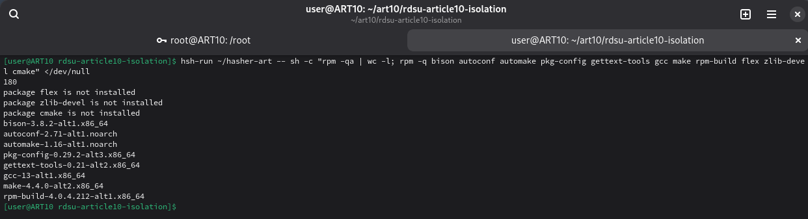
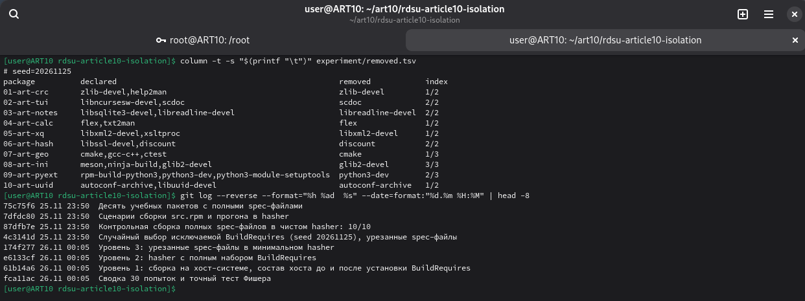
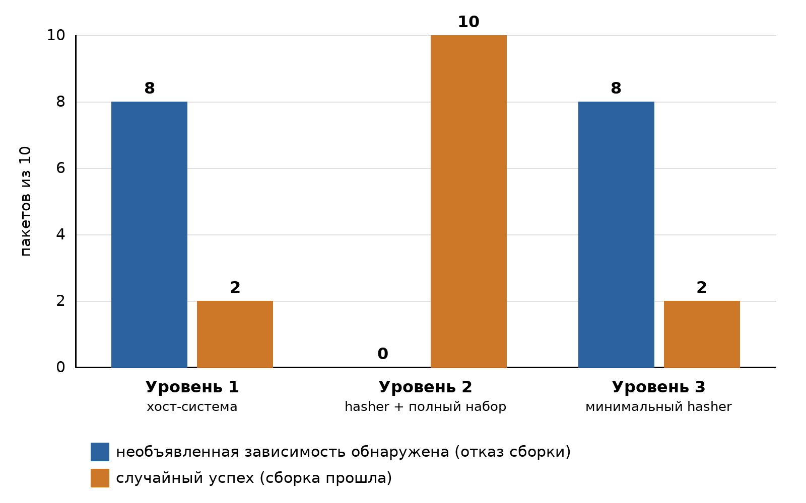
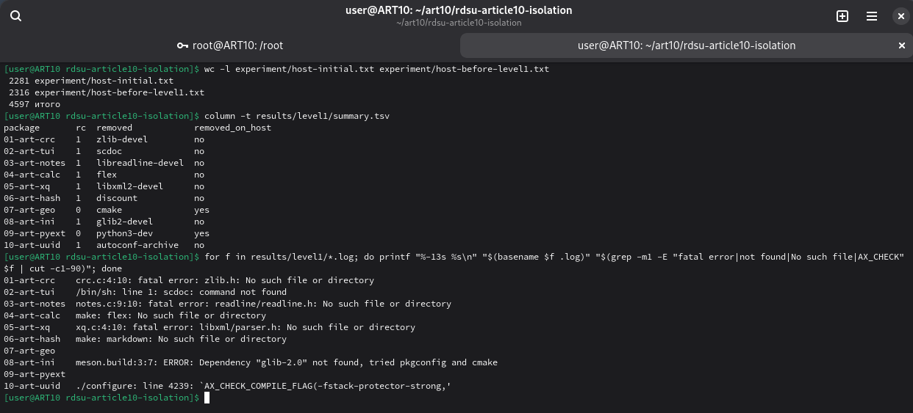
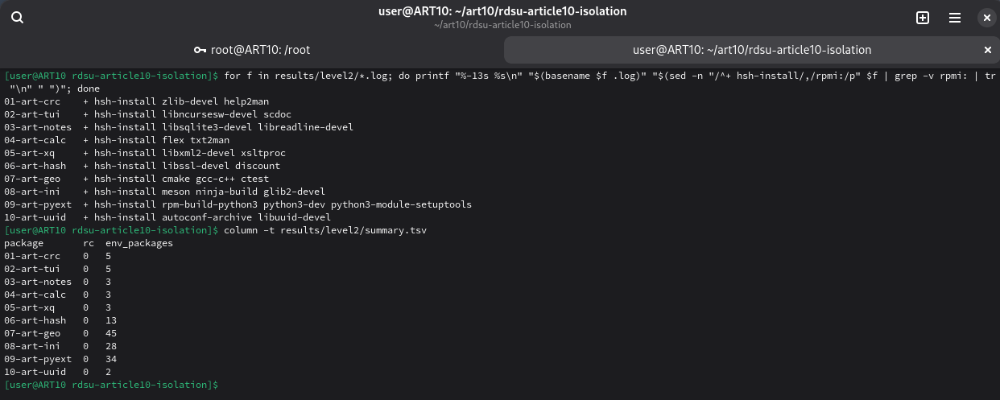
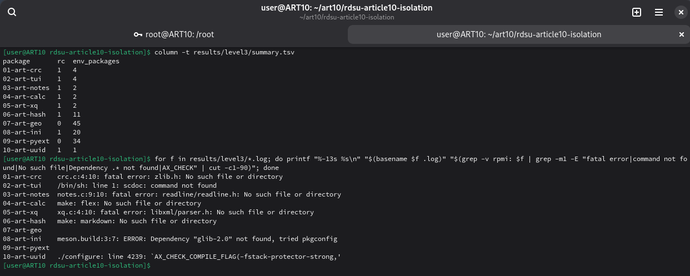
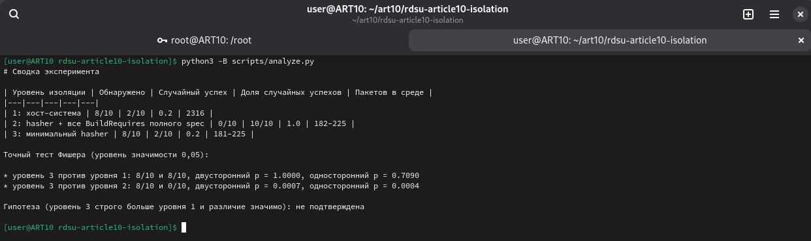
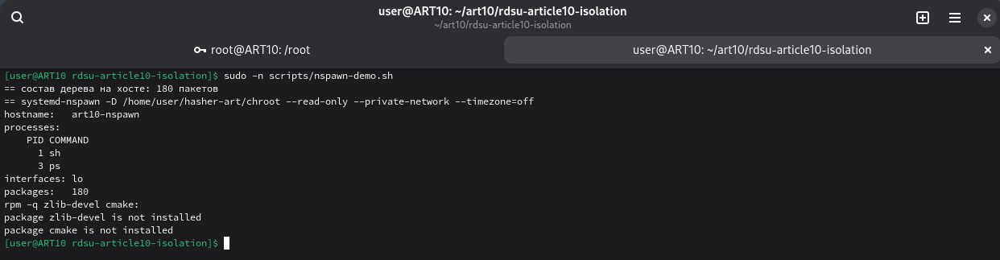

УДК 004.451.9

**А. А. Ащеулов, А. М. Джакишев**

РГУ нефти и газа (НИУ) имени И. М. Губкина, Москва

**Аннотация.** Неполный перечень сборочных зависимостей (BuildRequires) в spec-файле — распространённая ошибка сопровождения RPM-пакетов: пакет собирается на машине сопровождающего, но не собирается в сборочной системе дистрибутива или собирается в ней иначе. В работе экспериментально сравниваются три степени изоляции сборочной среды на платформе «Альт» (ветка p11): сборка в хост-системе без изоляции, сборка в окружении hasher с предварительно установленным полным набором зависимостей и сборка в минимальном окружении hasher, построенном только по объявленным зависимостям. Для десяти учебных пакетов из корректного spec-файла исключалась одна случайно выбранная директива BuildRequires; выполнено 30 попыток сборки. Минимальное окружение и хост-система обнаружили по 8 из 10 необъявленных зависимостей, окружение с полным набором — ни одной; гипотеза о преимуществе минимального окружения над хост-системой на данном стенде не подтвердилась (точный тест Фишера, p = 1,0). Оба пропуска на хосте и в минимальном окружении вызваны не посторонними пакетами, а транзитивными зависимостями объявленных пакетов (`ctest` → `cmake`, `python3-module-setuptools` → `python3-dev`); такую маскировку изоляция не устраняет. Показано также, что «минимальное» окружение hasher содержит базовый набор из 180 пакетов, в том числе `bison`, `autoconf` и `pkg-config`, отсутствие которых в BuildRequires не может быть обнаружено ни на одном уровне.

**Ключевые слова:** сборочные зависимости, BuildRequires, hasher, изоляция сборочной среды, RPM, Альт Платформа, systemd-nspawn, воспроизводимость сборки.

# Введение

Сборочные зависимости RPM-пакета объявляются директивами `BuildRequires` spec-файла. Сборочная система дистрибутива строит окружение по этому перечню, поэтому пропущенная зависимость приводит либо к отказу сборки, либо — что опаснее — к «тихому» изменению результата: например, необязательная возможность программы отключается сценарием `configure`, не найдя заголовочного файла. На машине сопровождающего ошибка обычно не видна: нужный пакет уже установлен для других целей.

Для платформы «Альт» штатным средством сборки является hasher — инструмент, который для каждой сборки создаёт изолированное окружение из пакетов репозитория [2, 3]. Распространено мнение, что именно изоляция «ловит» пропущенные зависимости. Однако изоляция и состав окружения — разные свойства: изолированное окружение с избыточным составом скрывает ошибку так же, как и хост-система. Цель работы — количественно оценить, как степень изоляции влияет на обнаружение необъявленных зависимостей.

**Исследовательский вопрос.** Как степень изоляции сборочной среды (хост-система без изоляции; hasher с полным набором пакетов, объявленных корректной версией spec-файла; минимальный hasher, содержащий только объявленные в урезанном spec-файле зависимости) влияет на число необъявленных сборочных зависимостей, обнаруживаемых при сборке набора учебных пакетов с намеренно неполным перечнем BuildRequires?

**Гипотеза.** Минимальное изолированное окружение обнаруживает достоверно больше необъявленных сборочных зависимостей, чем сборка в хост-системе, где недостающие зависимости маскируются случайно установленными посторонними пакетами.

# Средства изоляции сборочной среды

**hasher.** Окружение hasher — дерево каталогов, в которое с помощью apt устанавливаются пакеты из заданного репозитория [2]. Привилегированные операции выполняет служебный процесс `hasher-priv`; внутри окружения процессы работают от имени выделенных непривилегированных пользователей (сборщика и служебного «суперпользователя»), в отдельных пространствах имён монтирования, межпроцессного взаимодействия и сети, без доступа к сети по умолчанию; файловые системы хоста (`/proc`, `/dev/pts`) монтируются только по явному разрешению. Важная для данной работы особенность — **состав** окружения: сначала разворачивается базовый набор пакетов, необходимый любой сборке (компилятор, `make`, `rpm-build` и их зависимости), затем `hsh` устанавливает пакеты, перечисленные в BuildRequires собираемого src.rpm, вместе с их зависимостями. Команды `hsh-install` и `hsh-rebuild` позволяют доставить в окружение произвольные пакеты и собрать пакет в уже подготовленном окружении.

**systemd-nspawn.** Утилита запускает команду или полноценную систему в контейнере на основе пространств имён ядра (процессов, монтирования, сети, имени узла) [4]. В отличие от hasher, она не строит дерево ОС и не управляет его составом: каталог с системой подготавливается заранее любым способом, запуск требует прав суперпользователя. Поэтому nspawn обеспечивает изоляцию, но не минимальность окружения.

**Архитектура изоляции.** В работе [1] современные платформы изоляции — от контейнеров на пространствах имён ядра до лёгких виртуальных машин — сравниваются по архитектуре и производительности. Для задачи выявления зависимостей существенно не то, каким механизмом ядра обеспечена изоляция, а то, *что* находится внутри изолированной среды. Эксперимент построен так, чтобы разделить эти два фактора: уровни 2 и 3 используют один и тот же механизм изоляции (hasher) и различаются только составом окружения.

# Методика эксперимента

## Стенд

Виртуальная машина VirtualBox 7.0, ALT Workstation 11.1 (ветка p11), ядро 6.12.41, `hasher` 1.7.7, `hasher-priv` 2.0.14, `rpm-build` 4.0.4.212, `apt` 0.5.15lorg2. Репозиторий для окружений hasher — зеркало ветки p11 (`mirror.yandex.ru/altlinux`). Все сценарии, spec-файлы, журналы и списки пакетов опубликованы в репозитории эксперимента [7].

## Учебные пакеты

Подготовлено десять учебных пакетов разной сложности: от одного файла на C с одной библиотекой до проектов на CMake, Meson и Autotools с тестами в секции `%check` (таблица 1). Каждый пакет имеет корректный spec-файл: все десять собираются в чистом окружении hasher (контрольная сборка, 10/10, каталог `results/control`).

Таблица 1 — Учебные пакеты и их сборочные зависимости

| № | Пакет | Система сборки, назначение | BuildRequires полного spec-файла |
|---|---|---|---|
| 01 | art-crc | make; CRC-32/Adler-32, страница man из `--help` | zlib-devel, help2man |
| 02 | art-tui | make + pkg-config; ncursesw, man из scdoc | libncursesw-devel, scdoc |
| 03 | art-notes | make; SQLite + readline | libsqlite3-devel, libreadline-devel |
| 04 | art-calc | flex + bison; man из txt2man | flex, txt2man |
| 05 | art-xq | make; XPath на libxml2, man через XSLT | libxml2-devel, xsltproc |
| 06 | art-hash | make; OpenSSL EVP, gettext, документация из Markdown | libssl-devel, discount |
| 07 | art-geo | CMake + CTest, C++17 | cmake, gcc-c++, ctest |
| 08 | art-ini | Meson + Ninja, GLib | meson, ninja-build, glib2-devel |
| 09 | art-pyext | setuptools; модуль расширения Python на C | rpm-build-python3, python3-dev, python3-module-setuptools |
| 10 | art-uuid | Autoconf/Automake + autoconf-archive, libuuid | autoconf-archive, libuuid-devel |

**Поправка на базовый набор hasher.** В первоначальной версии spec-файлов были объявлены также `pkg-config` (02), `bison` (04), `gettext-tools` (06), `autoconf` и `automake` (10) — всего 5 из 24 директив. Контрольная сборка показала, что все пять пакетов входят в базовый набор окружения hasher (180 пакетов, рисунок 1), который присутствует при любой сборке и по правилам сопровождения в BuildRequires не указывается. Исключение такой директивы не создаёт необъявленной зависимости в смысле дистрибутива и не может быть обнаружено ни на одном уровне. Поэтому **до** случайного выбора эти директивы были заменены зависимостями вне базового набора (`scdoc`, `txt2man`, `discount`, `autoconf-archive`) с соответствующим использованием в исходниках; итоговые spec-файлы содержат 23 директивы BuildRequires.

## Выбор исключаемой зависимости

Для каждого пакета одна директива BuildRequires выбиралась равновероятно генератором псевдослучайных чисел Python с фиксированным зерном 20261125 (сценарий `scripts/pick-removed.py`); урезанный spec-файл — копия полного без выбранной строки. Выбор и зерно зафиксированы в репозитории (`experiment/removed.tsv`) до снятия состава хост-системы, что исключает подгонку выборки под её состав (рисунок 2).

## Уровни изоляции

Для каждого из уровней собирались десять урезанных src.rpm; src.rpm создавались одинаково для всех уровней (`scripts/make-srpm.sh`, `rpmbuild -bs --nodeps`).

**Уровень 1 — хост-система.** `rpmbuild --rebuild` без изоляции. Состав хост-системы экспериментатором не подбирался: это рабочая станция ALT Workstation с 2281 установленным пакетом (`experiment/host-initial.txt`), на которой ранее выполнялись лабораторные работы курса. Поскольку `rpmbuild` отказывается собирать пакет без *объявленных* зависимостей, на хост, как это сделал бы разработчик, были установлены зависимости, объявленные в урезанных spec-файлах (13 пакетов; apt добавил 35 пакетов с учётом зависимостей). Состав непосредственно перед экспериментом — 2316 пакетов (`experiment/host-before-level1.txt`).

**Уровень 2 — hasher с полным набором.** Для каждого пакета создавалось новое окружение (`hsh --initroot-only`), в него устанавливались все BuildRequires *полного* spec-файла (`hsh-install`), затем урезанный src.rpm собирался в этом окружении (`hsh-rebuild`).

**Уровень 3 — минимальный hasher.** Для каждого пакета — новое окружение, сборка урезанного src.rpm командой `hsh`, которая ставит только объявленные в нём зависимости.

Состав окружения для каждой попытки восстанавливался по журналу установки пакетов (`results/levelN/*.pkgs`) и базовому набору.

## Метрики и критерий

Попытка считается **обнаружившей** необъявленную зависимость, если сборка завершилась отказом и в журнале есть диагностика, относящаяся к исключённому пакету (отсутствующий заголовочный файл, команда, модуль pkg-config или макрос; шаблоны — в `scripts/analyze.py`). Сборка, прошедшая несмотря на неполный перечень, — **случайный успех**. Отказов по посторонним причинам в эксперименте не было.

Метрики по каждому уровню: число обнаруженных необъявленных зависимостей из 10 и доля случайных успехов. Гипотеза считается подтверждённой, если на уровне 3 обнаружений строго больше, чем на уровне 1, и различие значимо по точному тесту Фишера [6] при уровне значимости 0,05. Повторность — одна сборка на пакет и уровень: при фиксированном составе окружения результат детерминирован.

# Результаты

Все 30 попыток выполнены. Сводные результаты приведены в таблице 2 и на рисунке 3, поштучные — в таблице 3; полные журналы — в каталогах `results/level1`–`results/level3`.

Таблица 2 — Результаты по уровням изоляции

| Уровень изоляции | Обнаружено | Случайный успех | Доля случайных успехов | Пакетов в среде |
|---|---|---|---|---|
| 1: хост-система | 8/10 | 2/10 | 0,2 | 2316 |
| 2: hasher + все BuildRequires полного spec | 0/10 | 10/10 | 1,0 | 182–225 |
| 3: минимальный hasher | 8/10 | 2/10 | 0,2 | 181–225 |

Таблица 3 — Исходы и диагностика по пакетам

| Пакет | Исключена | Ур. 1 | Ур. 2 | Ур. 3 | Диагностика при отказе (уровни 1 и 3) |
|---|---|---|---|---|---|
| art-crc | zlib-devel | отказ | успех | отказ | `fatal error: zlib.h: No such file or directory` |
| art-tui | scdoc | отказ | успех | отказ | `scdoc: command not found` |
| art-notes | libreadline-devel | отказ | успех | отказ | `fatal error: readline/readline.h: No such file or directory` |
| art-calc | flex | отказ | успех | отказ | `make: flex: No such file or directory` |
| art-xq | libxml2-devel | отказ | успех | отказ | `fatal error: libxml/parser.h: No such file or directory` |
| art-hash | discount | отказ | успех | отказ | `make: markdown: No such file or directory` |
| art-geo | cmake | успех | успех | успех | — |
| art-ini | glib2-devel | отказ | успех | отказ | `ERROR: Dependency "glib-2.0" not found` |
| art-pyext | python3-dev | успех | успех | успех | — |
| art-uuid | autoconf-archive | отказ | успех | отказ | `./configure: syntax error near unexpected token` у `AX_CHECK_COMPILE_FLAG` |

На уровне 1 все восемь отказов сопровождались той же диагностикой, что и на уровне 3 (рисунок 4); на уровне 2 все десять пакетов собрались (рисунок 5); на уровне 3 — восемь отказов (рисунок 6).

**Проверка гипотезы.** Для уровней 3 и 1 таблица сопряжённости — 8/2 и 8/2: двусторонний p = 1,000, односторонний p = 0,709. Критерий подтверждения не выполнен: обнаружений на уровне 3 не больше, чем на уровне 1, **гипотеза на данном стенде не подтверждена**. Дополнительно сравнены уровни 3 и 2: 8/2 против 0/10, двусторонний p = 0,0007 — различие значимо (рисунок 7).

# Обсуждение

**Почему хост-система не уступила минимальному окружению.** Механизм, заложенный в гипотезу, — маскировка необъявленной зависимости посторонним пакетом, случайно установленным на хосте, — в эксперименте не проявился ни разу: ни одна из десяти исключённых зависимостей не была установлена на хосте до подготовки к эксперименту. Рабочая станция ALT Workstation ориентирована на пользователя, а не на разработчика: в её составе из 2281 пакета практически нет пакетов `-devel`, а все предыдущие сборки на этой машине выполнялись в hasher и хост не засоряли. Для значимого результата при 8/10 на уровне 3 на уровне 1 должно было быть не более 2 обнаружений (двусторонний p = 0,023), то есть хост должен был замаскировать не менее шести из восьми зависимостей, выявленных минимальным окружением. Такое возможно на машине, где годами собирают пакеты без изоляции, — именно поэтому результат уровня 1 принципиально зависит от истории хоста (см. ограничения валидности).

**Структурная маскировка.** Оба случайных успеха одинаковы на уровнях 1 и 3 и вызваны транзитивными зависимостями объявленных пакетов: пакет `ctest` требует `cmake` той же версии, а `python3-module-setuptools` требует `python3-dev`. На хост эти пакеты попали при установке объявленных зависимостей, в минимальное окружение — по той же причине. Такую маскировку не устраняет никакая степень изоляции, потому что она порождается самим неполным перечнем. Она не ломает сборку сейчас, но делает пакет зависимым от внутреннего устройства чужих пакетов: если `python3-module-setuptools` перестанет требовать `python3-dev`, пакет `art-pyext` перестанет собираться. Выявить её можно только анализом — сравнением фактически использованных при сборке файлов с объявленным перечнем (в «Альт» эту задачу решает утилита `buildreq`).

**Изоляция без минимального состава бесполезна для этой задачи.** Уровень 2 использует тот же механизм изоляции, что и уровень 3, но с полным набором зависимостей не обнаружил ни одной ошибки (p = 0,0007 при сравнении с уровнем 3). Значит, обнаружение определяется не изоляцией как таковой, а тем, что окружение строится *только* из объявленного перечня. Изоляция нужна для того, чтобы этот состав был гарантирован и воспроизводим — в том числе не зависел от истории машины. Тот же вывод следует из сопоставления с systemd-nspawn: контейнер обеспечивает изоляцию процессов и сети, но запускается на готовом дереве, состав которого контейнер не определяет (рисунок 8). Если запустить сборку в nspawn на дереве, подготовленном «с запасом», результат совпадёт с уровнем 2.

Таблица 4 — Сопоставление сред сборки

| Свойство | Хост-система | hasher | systemd-nspawn |
|---|---|---|---|
| Состав среды | история машины | базовый набор + объявленные BuildRequires | любое заранее подготовленное дерево |
| Права для запуска | пользователь | пользователь (через `hasher-priv`) | суперпользователь |
| Изоляция процессов, монтирования, сети | нет | да (сеть по умолчанию отключена) | да |
| Воспроизводимость состава | нет | да (по репозиторию) | определяется способом подготовки дерева |
| Назначение | разработка | сборка пакетов дистрибутива | запуск систем и служб в контейнере |

**«Минимальное» окружение не пусто.** Базовый набор hasher содержит 180 пакетов, в том числе генераторы анализаторов, Autotools и `pkg-config`. Зависимости из этого набора не обнаруживаются ни на одном уровне; правила сопровождения и не требуют их объявлять. Это сознательный компромисс дистрибутива, но для экспериментов с зависимостями его нужно учитывать: в первоначальном варианте нашей выборки на такие пакеты пришлось 5 из 24 директив, и при случайном выборе они дали бы «необнаружимые» исключения.

**Качество диагностики.** Ни в одном из 16 отказов диагностика не называет недостающий *пакет*. В шести случаях указан отсутствующий файл или команда (`zlib.h`, `scdoc`, `flex`), в одном — модуль pkg-config (`glib-2.0`), и пакет определяется поиском по файлу (`apt-file`, `rpm -qf` на машине, где он установлен). В случае `art-uuid` диагностика косвенная: макрос `AX_CHECK_COMPILE_FLAG` без пакета `autoconf-archive` остаётся нераскрытым, и ошибку выдаёт командная оболочка при выполнении `configure`. Утверждение гипотезы о «точном указании недостающего пакета» не подтверждается ни для одного уровня. Отметим также, что текст диагностики зависит от состава среды: Meson на хосте сообщил «tried pkgconfig and cmake», а в минимальном окружении — «tried pkgconfig», поскольку `cmake` там не было.

# Ограничения валидности

* Результат уровня 1 определяется составом конкретной хост-системы на момент опыта (2316 пакетов, список зафиксирован в репозитории) и не воспроизводим на другой машине без повторной фиксации её состава; на «загрязнённой» машине разработчика доля случайных успехов может быть существенно выше.
* Подготовка хоста включала установку объявленных зависимостей всех десяти урезанных пакетов одновременно; на исход это не повлияло (обе маскировки — внутренние зависимости собственных объявленных пакетов), но в общем случае зависимости одного пакета могут маскировать ошибки другого.
* Исследуются только директивы BuildRequires; эксплуатационные зависимости, вычисляемые автоматически при сборке, не рассматриваются.
* Пять директив, относящихся к базовому набору hasher, заменены до случайного выбора; выборка из десяти учебных пакетов не репрезентативна относительно репозитория Сизиф.
* Объём выборки (10 пакетов на уровень) позволяет обнаружить только крупные различия: при 8/10 на уровне 3 значимым было бы лишь различие с уровнем 1 не более 2/10.

# Заключение

Выполнено 30 сборок десяти учебных пакетов с одной случайно исключённой директивой BuildRequires при трёх степенях изоляции сборочной среды. Минимальное окружение hasher и хост-система обнаружили по 8 из 10 необъявленных зависимостей, окружение hasher с полным набором зависимостей — ни одной. Гипотеза о достоверном преимуществе минимального окружения над хост-системой на исследованном стенде не подтвердилась (p = 1,0): хост пользовательской рабочей станции, на которой пакеты ранее собирались только в hasher, не содержал ни одной из исключённых зависимостей.

Эксперимент показал, что выявление необъявленных зависимостей определяется составом сборочной среды, а не механизмом изоляции: одинаково изолированные окружения уровней 2 и 3 дали 0 и 8 обнаружений (p = 0,0007). Изоляция ценна тем, что делает минимальный состав гарантированным и независимым от истории машины, тогда как результат сборки на хосте случаен по своей природе. Две необъявленные зависимости остались незамеченными на всех уровнях, так как приходили транзитивно через объявленные пакеты; базовый набор hasher из 180 пакетов делает часть зависимостей необнаружимой в принципе. Для полного контроля перечня BuildRequires сборку в минимальном окружении следует дополнять анализом фактически использованных файлов.

Все spec-файлы (полные и урезанные), протоколы 30 попыток сборки, списки пакетов хоста и окружений, а также сценарии проведения и обработки эксперимента опубликованы в репозитории [7].

# Список источников

1. van Rijn V., Rellermeyer J. S. A Fresh Look at the Architecture and Performance of Contemporary Isolation Platforms // Proceedings of the 22nd International Middleware Conference (Middleware '21). — ACM, 2021. — P. 323–335. — DOI: 10.1145/3464298.3493404.
2. hasher(8) — руководство по hasher : страница справочного руководства. — ALT Linux Team.
3. Альт Платформа : руководство. Глава 8. Инструмент Hasher. — ООО «Базальт СПО».
4. systemd-nspawn(1) — Spawn a command or OS in a light-weight container : страница справочного руководства. — systemd project.
5. rpmbuild(8) — Build RPM Package(s) : страница справочного руководства.
6. Fisher R. A. Statistical Methods for Research Workers. — Edinburgh : Oliver and Boyd, 1925.
7. Ащеулов А. А., Джакишев А. М. Репозиторий эксперимента «Влияние степени изоляции сборочной среды на выявление зависимостей». — URL: https://github.com/Amiran818/rdsu-article10-isolation.
